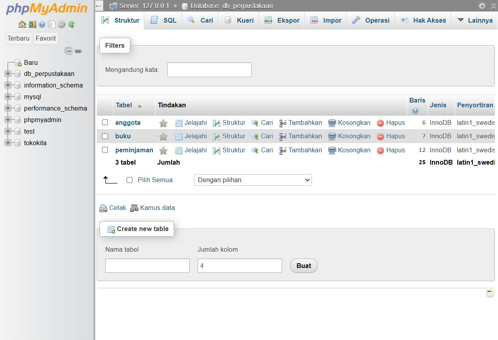
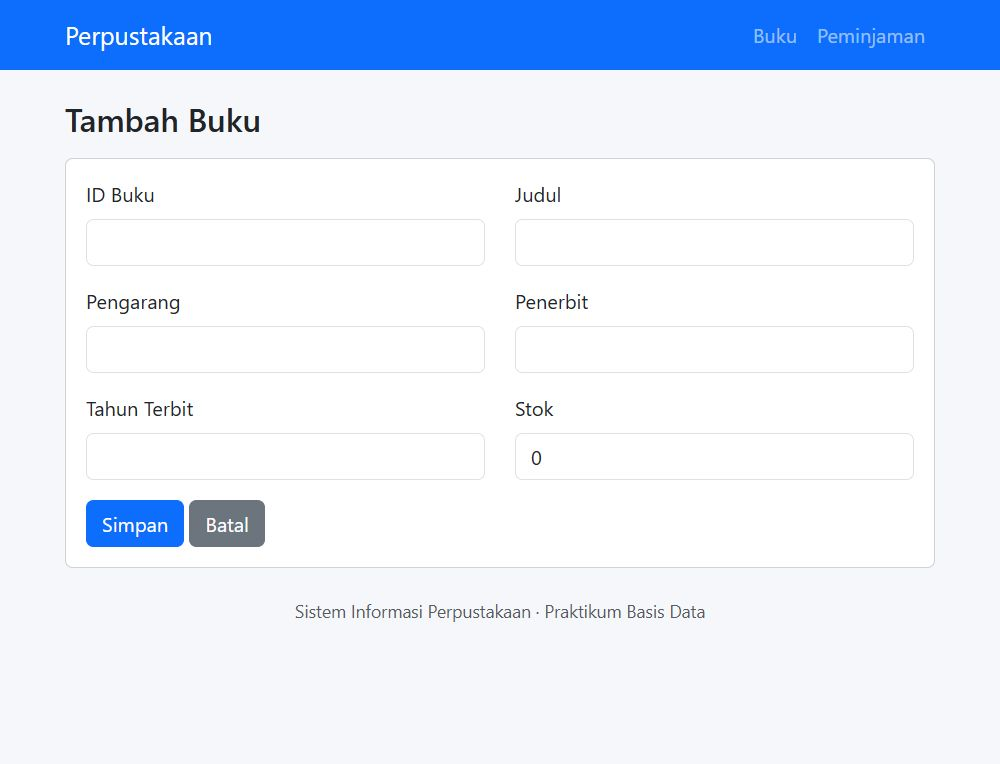
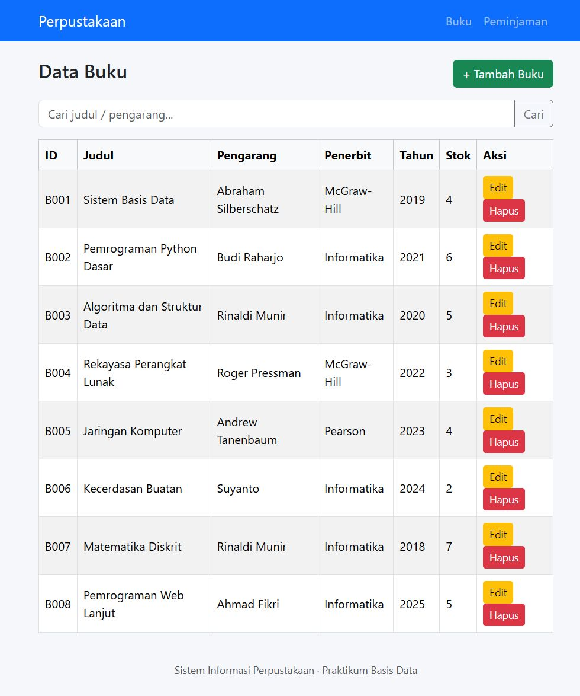
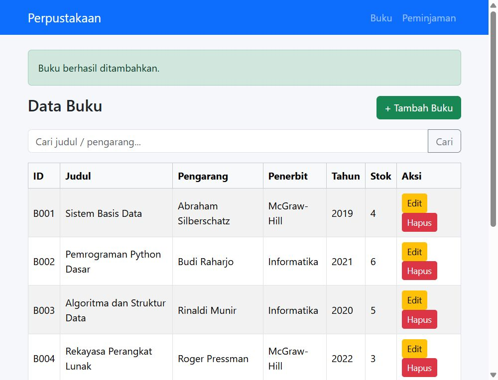
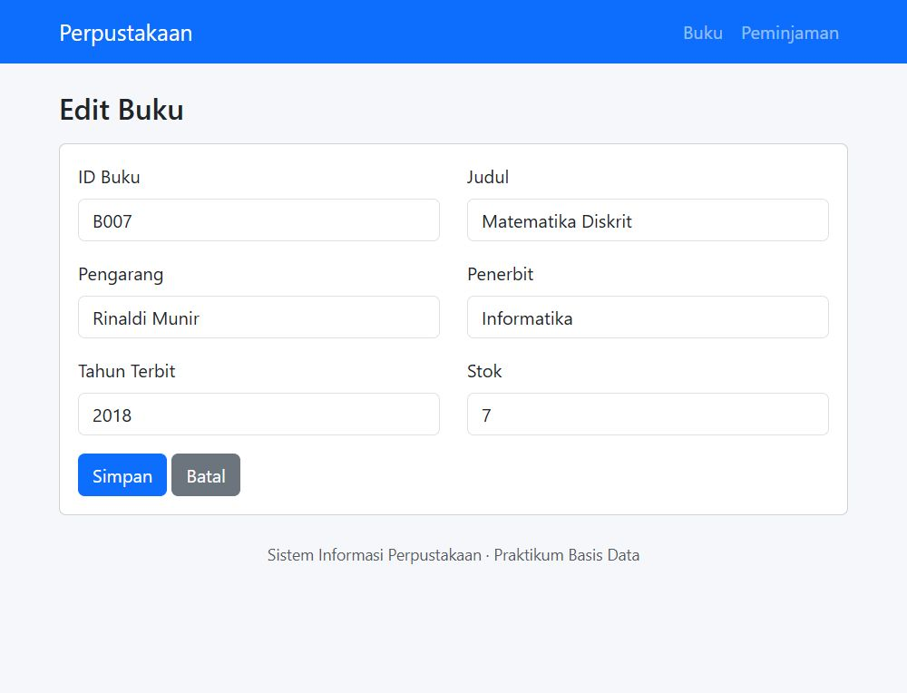
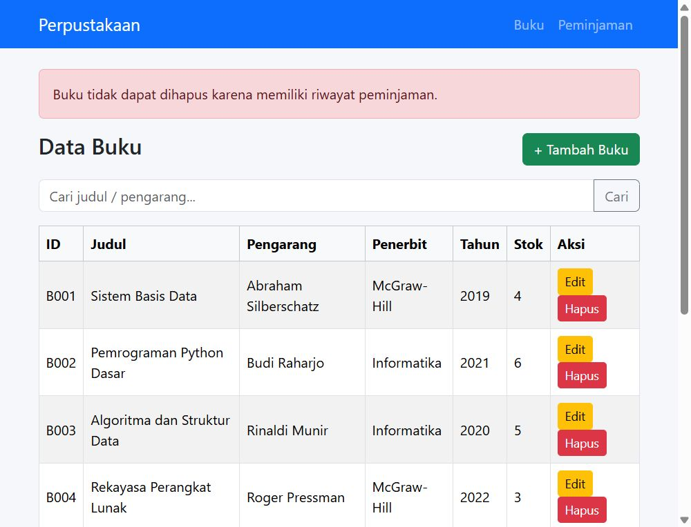
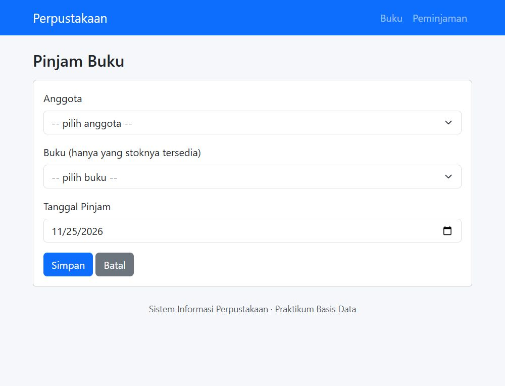
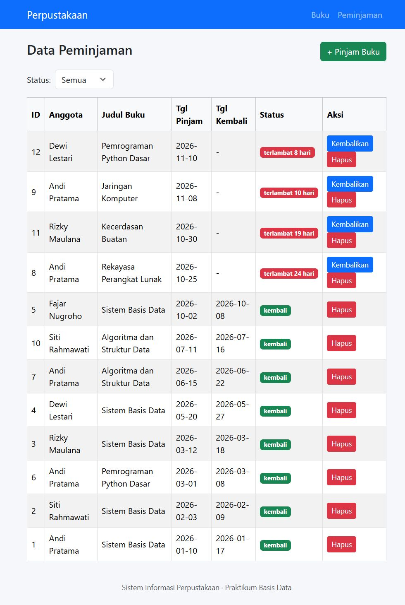

# Sistem Informasi Perpustakaan — CRUD Dasar (Studi Kasus 1)

**Mata Kuliah:** Basis Data — Materi Praktikum CRUD
**Teknologi yang dipilih:** **PHP Native** (PDO + MySQL/MariaDB)
**Database:** `db_perpustakaan`

## 📌 Identitas Mahasiswa

| | |
|---|---|
| **Nama** | Zaidan Fayyadh Ha'il Daffa |
| **NIM** | 26091397123 |
| **Kelas** | 2026D |

---

Aplikasi CRUD sederhana untuk mengelola **buku** dan **transaksi peminjaman** pada sebuah perpustakaan.

---

## 1. Konsep CRUD

| Operasi | SQL | HTTP | Penerapan pada aplikasi |
|---------|-----|------|--------------------------|
| **C**reate | `INSERT` | POST | Menambah buku, mencatat peminjaman |
| **R**ead | `SELECT` | GET | Daftar buku (pencarian), daftar peminjaman (JOIN) |
| **U**pdate | `UPDATE` | POST | Mengubah data buku, memproses pengembalian |
| **D**elete | `DELETE` | POST | Menghapus buku, menghapus transaksi |

---

## 2. Struktur Project

```
perpus-php/
├── index.php                  # pengalih ke halaman buku
├── config/
│   └── config.php             # konstanta aplikasi + koneksi PDO
├── includes/
│   ├── functions.php          # fungsi bantu: escape, flash, validasi
│   ├── header.php             # <head> + navbar + pesan flash
│   └── footer.php             # penutup HTML
├── assets/
│   └── css/style.css          # CSS tambahan
├── database/
│   ├── db_perpustakaan.sql    # skrip pembuatan DB + data awal
│   └── tes_crud.php           # pengujian otomatis 16 skenario
├── buku/                      # ===== MODUL BUKU =====
│   ├── index.php              # READ   : daftar + pencarian
│   ├── tambah.php             # CREATE : form + simpan
│   ├── edit.php               # UPDATE : form + perbarui
│   ├── hapus.php              # DELETE : hapus (POST saja)
│   └── _form.php              # potongan form (dipakai tambah & edit)
├── peminjaman/                # ===== MODUL PEMINJAMAN =====
│   ├── index.php              # READ   : daftar transaksi (JOIN)
│   ├── tambah.php             # CREATE : catat peminjaman (transaksi DB)
│   ├── kembalikan.php         # UPDATE : proses pengembalian (transaksi DB)
│   └── hapus.php              # DELETE : hapus transaksi (transaksi DB)
└── screenshots/               # tangkapan layar aplikasi (7 gambar)
```

---

## 3. Prasyarat

- **XAMPP** (atau Laragon) dengan **PHP ≥ 8.0** + ekstensi `pdo_mysql`
- **MySQL / MariaDB** (bawaan XAMPP)
- Browser

---

## 4. Cara Menjalankan

### Langkah 1 — Salin folder project
Letakkan folder `perpus-php` ke dalam folder web server:
- **XAMPP** → `C:\xampp\htdocs\perpus-php`
- **Laragon** → `C:\laragon\www\perpus-php`

### Langkah 2 — Nyalakan Apache & MySQL
Buka **XAMPP Control Panel** → tekan tombol **Start** pada **Apache** dan **MySQL**.
Pastikan keduanya bertanda **hijau** (running).

> Port default: Apache = `80`, MySQL = `3306`.

### Langkah 3 — Buat basis data
Buka **phpMyAdmin**: <http://localhost/phpmyadmin>

1. Klik tab **SQL**.
2. Tempel seluruh isi file [`database/db_perpustakaan.sql`](database/db_perpustakaan.sql).
3. Klik **Go**.

Skrip ini akan otomatis membuat:
- Database `db_perpustakaan`
- Tabel `anggota`, `buku`, `peminjaman`
- Data awal: **7 buku**, **6 anggota**, **12 transaksi peminjaman**

Hasilnya di phpMyAdmin:



**Alternatif lewat terminal:**

```bash
cd C:\xampp\htdocs\perpus-php\database
mysql -u root < db_perpustakaan.sql
```

### Langkah 4 — Jalankan aplikasi
Buka browser dan akses:

```
http://localhost/perpus-php/
```

Aplikasi akan mengarahkan ke halaman **Data Buku**.

### Langkah 5 — Mulai gunakan
Gunakan menu navigasi di bagian atas untuk berpindah antar modul:
- **Buku** → kelola data buku (tambah, cari, edit, hapus)
- **Peminjaman** → catat peminjaman, kembalikan buku, hapus transaksi

### Konfigurasi (opsional)
Jika folder diberi nama lain, atau kredensial MySQL Anda berbeda
(mis. root memakai password), ubah nilai berikut di `config/config.php`:

```php
define('BASE_URL', '/perpus-php');   // sesuaikan dengan nama folder
define('DB_HOST', 'localhost');
define('DB_NAME', 'db_perpustakaan');
define('DB_USER', 'root');
define('DB_PASS', '');               // isi password bila ada
```

### Menjalankan dengan server bawaan PHP (alternatif tanpa XAMPP)
Set `BASE_URL` menjadi `''` di `config/config.php`, lalu:

```bash
cd perpus-php
php -S localhost:8000
```

Buka <http://localhost:8000/>.

---

## 5. Skema Basis Data

```
anggota                 peminjaman                buku
┌──────────────┐       ┌──────────────────┐      ┌────────────────┐
│ id_anggota PK├──────►│ id_anggota  (FK) │      │ id_buku PK     │
│ nama         │   N:1 │ id_pinjam PK(AI) │      │ judul          │
│ alamat       │       │ id_buku    (FK)  ├─────►│ pengarang      │
│ tgl_daftar   │       │ tgl_pinjam       │  1:N │ penerbit       │
└──────────────┘       │ tgl_kembali      │      │ tahun_terbit   │
                       │ status ENUM      │      │ stok           │
                       └──────────────────┘      └────────────────┘
```

---

## 6. Aturan Bisnis

1. **Stok** = jumlah eksemplar tersedia. Dipinjam → stok −1; dikembalikan → stok +1. Stok `0` tidak dapat dipinjam.
2. **Batas peminjaman 7 hari.** Keterlambatan = `GREATEST(DATEDIFF(CURDATE(), tgl_pinjam) - 7, 0)`.
3. **ID buku berformat `Bxxx`** (contoh `B008`) dan **tidak dapat diubah** setelah tersimpan (primary key).
4. **Buku dengan riwayat peminjaman tidak dapat dihapus** — dijaga otomatis oleh *foreign key* (error MySQL `1451`).

---

## 7. Teknik yang Diterapkan

| Teknik | Penjelasan |
|--------|-----------|
| **Prepared statement** | Semua query memakai parameter terpisah → mencegah **SQL injection** |
| **Escape HTML (`htmlspecialchars`)** | Mencegah **XSS** pada setiap output |
| **Validasi dua lapis** | Atribut HTML (`required`, `min`) + validasi di server (`validasi_buku`) |
| **Post/Redirect/Get (PRG)** | Setelah POST selalu redirect → data tidak tersimpan ganda saat refresh |
| **Transaksi DB (`beginTransaction`)** | Peminjaman/pengembalian = 2 perubahan yang harus bersama-sama berhasil |
| **`SELECT ... FOR UPDATE`** | Mengunci baris buku → stok tidak pernah menjadi negatif saat bersamaan |
| **Pesan flash (session)** | Hasil aksi ditampilkan sekali lalu hilang |
| **Penanganan error constraint** | `1062` (duplikat), `1451` (FK ditolak), `1452` (referensi hilang) |

### Kode error yang ditangani

| Kode | Nama | Penyebab |
|------|------|----------|
| 1062 | `ER_DUP_ENTRY` | Menambah buku dengan ID sudah ada |
| 1451 | `ER_ROW_IS_REFERENCED_2` | Menghapus buku yang punya riwayat peminjaman |
| 1452 | `ER_NO_REFERENCED_ROW_2` | Peminjaman dengan ID anggota/buku tidak ada |

---

## 8. Skenario Pengujian

| No | Langkah | Hasil yang diharapkan | Status |
|----|---------|----------------------|--------|
| 1 | Buka halaman Buku | Tabel menampilkan 7 buku (B001–B007) | ✅ |
| 2 | Cari kata kunci `munir` | Tampil 2 buku: B003 dan B007 | ✅ |
| 3 | Tambah buku **B008** | Pesan sukses; B008 muncul di tabel | ✅ |
| 4 | Tambah lagi **B008** | Ditolak: *"ID buku sudah digunakan"* (1062) | ✅ |
| 5 | Tambah buku ID **X1** | Ditolak validasi: format harus `Bxxx` | ✅ |
| 6 | Edit B008, stok → 8 | Pesan sukses; ID tidak dapat diubah | ✅ |
| 7 | Hapus **B008** | Pesan sukses; B008 hilang dari tabel | ✅ |
| 8 | Hapus **B001** | Ditolak: punya riwayat peminjaman (1451) | ✅ |
| 9 | Buka halaman Peminjaman | 12 transaksi tampil (INNER JOIN) | ✅ |
| 10 | Filter status `dipinjam` | Hanya transaksi berstatus dipinjam | ✅ |
| 11 | A006 pinjam B007 | Stok B007 turun 7 → 6 | ✅ |
| 12 | Kembalikan transaksi | Status `kembali`, stok kembali 7 | ✅ |
| 13 | Pinjamkan B006 dua kali | Stok 0; B006 hilang dari dropdown | ✅ |
| 14 | Hapus transaksi B006 | Terhapus; stok B006 bertambah 1 | ✅ |

### Query verifikasi langsung di MySQL

```sql
SELECT id_buku, judul, stok FROM buku WHERE id_buku IN ('B006', 'B007');
SELECT * FROM peminjaman ORDER BY id_pinjam DESC LIMIT 5;
```

### Uji otomatis

Seluruh skenario di atas diotomatisasi dalam [`database/tes_crud.php`](database/tes_crud.php).
Skrip ini melakukan request HTTP sungguhan ke aplikasi (dengan *cookie jar* agar pesan flash
dapat dibaca) dan memverifikasi isi basis data lewat MySQL.

```bash
# pastikan Apache & MySQL sudah menyala, lalu:
php database/tes_crud.php
```

Hasil terakhir: **16 PASS / 0 FAIL**.

---

## 9. Tangkapan Layar

### 9.1 Basis Data


### 9.2 Modul Buku

| Operasi | Tangkapan layar |
|---------|----------------|
| **Create** |  |
| **Read** (daftar + pencarian) |  |
| **Read** (pesan flash sukses — Post/Redirect/Get) |  |
| **Update** (kolom ID *readonly*) |  |
| **Delete** ditolak *foreign key* (error 1451) |  |

### 9.3 Modul Peminjaman

| Operasi | Tangkapan layar |
|---------|----------------|
| **Create** (dropdown anggota & buku yang stoknya tersedia) |  |
| **Read** (INNER JOIN + filter status + badge keterlambatan) |  |

---

## 10. Sumber

Materi praktikum **"CRUD Dasar — Studi Kasus 1: Sistem Informasi Perpustakaan"**,
Mata Kuliah Basis Data, Semester Ganjil 2026/2027.
